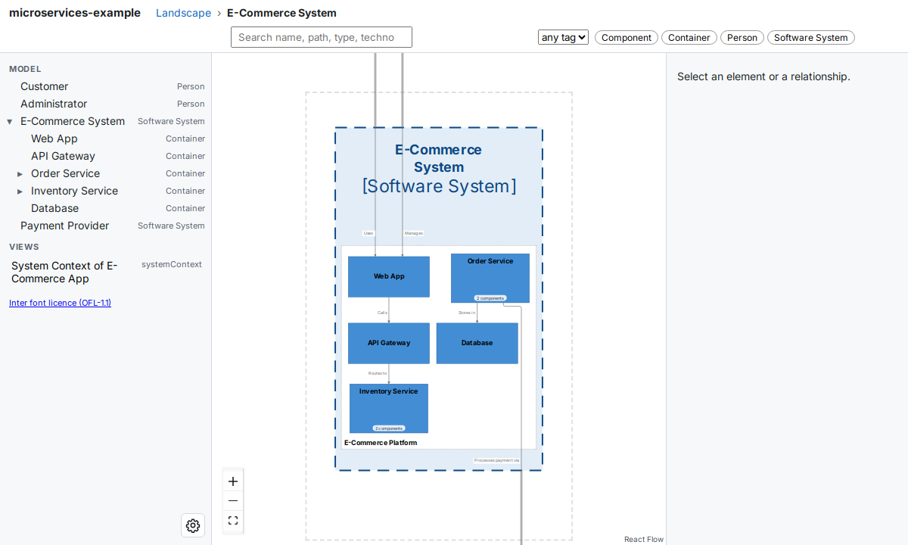
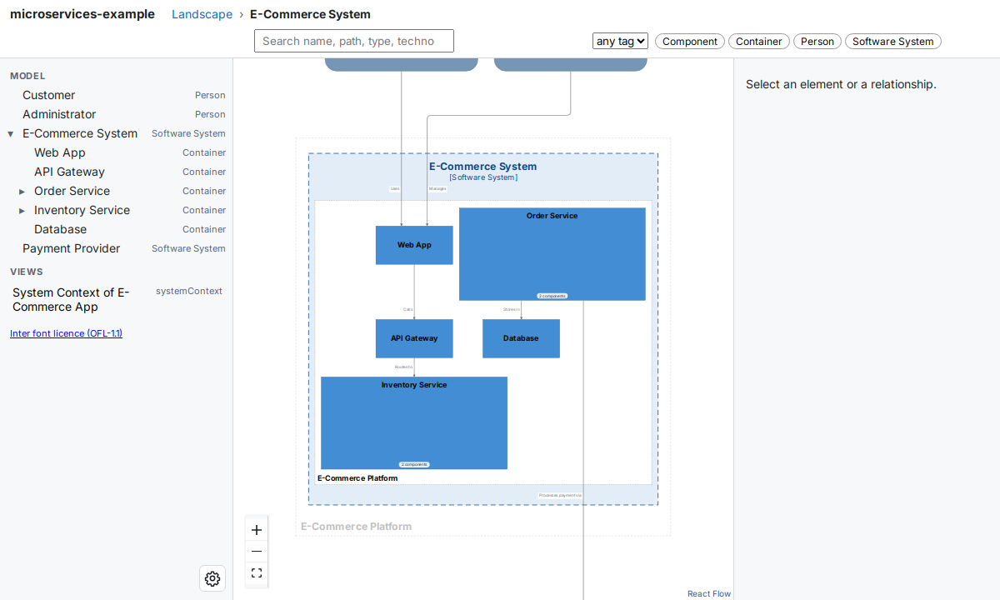

# Command reference

The `buildzr` command turns the architecture models that you write in Python into **built workspaces**: folders of web pages that draw your diagrams in a browser, with the model data next to them. It also serves them, so that you and other people can open them.

This page is the reference of the command: every option, its default, and every exit code. To learn the commands step by step, follow the [Quick Start](getting-started/quick-start.md), then [Serve your workspaces](serve-workspaces.md).

The command has two subcommands:

- `buildzr build` runs the Python files of your workspaces folder and writes one built workspace for each workspace they create.
- `buildzr serve` builds what is missing or out of date, then serves every built workspace so that you can open it in a browser.

## Find the page for your task

| You want to... | Read |
|---|---|
| Describe your architecture in Python | [Quick Start](getting-started/quick-start.md) and the [User Guide](user-guide/core-concepts.md) |
| Open your model in a browser | [Quick Start](getting-started/quick-start.md) |
| Serve several workspaces, on your machine or for a team | [Serve your workspaces](serve-workspaces.md) |
| Put the built workspaces on a web server you already have | [Hosting the built workspaces elsewhere](hosting.md) |
| Let scripts, CI (continuous integration) jobs, dashboards and AI assistants read your model | [The Model API](model-api.md) and the [recipes](publishing-recipes.md) |
| Keep your settings in one file | [`buildzr.yaml`](config.md) |
| Link to one box of a diagram | [Viewer links](viewer-hash-routes.md) |

## Words used on this page

| Word | Meaning |
|---|---|
| **workspace** | A `Workspace(...)` that you write in Python. It is also what readers open: its viewer, its data and its Model API, at `/<name>/` of `buildzr serve`. |
| **workspaces folder** | The folder of Python files that create your workspaces: `workspaces/` unless `-w` or the `workspaces:` key of `buildzr.yaml` names another one. One file may create several workspaces. |
| **model file** | One Python file of the workspaces folder. |
| **built workspace** | The folder that `buildzr build` writes for one workspace: the viewer, the model data and a file called `build.json`. |
| **build output** | The folder that holds every built workspace, one subfolder per workspace. Default: `.buildzr/build`. |
| **viewer** | The web page inside a built workspace that draws the diagrams. A workspace built with `--no-viewer` has the model data only and is called a **data-only workspace**. |
| **modelHash** | A fingerprint of the model, shown as `sha256:` and the start of a hash. The same model always gives the same hash. |
| **Model API** | The part of `buildzr serve` that answers questions about a model as JSON (a text format for data), under `/<name>/api/v1/`. |
| **`buildzr.yaml`** | The optional config file of your project. It holds the workspaces folder and the build settings. |

## Requirements and installation

You need:

- Python 3.10 or newer.
- Node.js 18 or newer on the machine that builds: `buildzr build`, and `buildzr serve` when a workspace is missing or out of date. The layout step of the build runs on Node. Check your version with `node --version`. Serving workspaces that are already built does not need Node.
- The `buildzr` package. Installing it also installs the `buildzr` command.

Install the package with pip:

```bash
pip install buildzr
```

If your project uses [uv](https://docs.astral.sh/uv/), add the package to it instead:

```bash
uv add buildzr
```

### Run the command without installing it

uv includes a tool called `uvx`, so install uv first. `uvx` runs a command in a temporary environment, and you do not install anything into your project. Put `uvx` in front of each command on this page, for example `uvx buildzr build`.

The temporary environment contains buildzr, so your model file can import it. If your model file imports other packages, add each one with `--with`:

```bash
uvx --with <package> buildzr build
```

## Commands and their options

### How the commands find their settings

Each setting comes from the first of these that has it:

1. An option on the command line.
2. `buildzr.yaml`.
3. The built-in default.

The tables below list every option. `buildzr COMMAND --help` prints the same list.

### `buildzr build`

```text
buildzr build [-h] [-w PATH] [--k N] [--text-color {wcag,c4}] [--no-viewer] [-c FILE] [-v] [-o DIR]
```

`build` runs every model file of the workspaces folder, each in a fresh Python process, lays out the diagrams of every workspace the files create, and writes each one to `<build output>/<name>/`. It always builds every workspace; `serve` is the command that builds only what is out of date.

| Option | What it does |
|---|---|
| `-w PATH`, `--workspaces PATH` | The Python file or folder that creates workspaces. Default: `workspaces:` in `buildzr.yaml`, else the folder `workspaces`. |
| `--k N` | Room for a box that contains other boxes, as a multiple of the area of an empty box. Raise it if the insides of such boxes are too small to read; lower it for compact diagrams. A whole number of at least 1. Default: `build.k` in `buildzr.yaml`, else 4. See [Choosing a value for `--k`](#choosing-a-value-for-k). |
| `--text-color {wcag,c4}` | The text colour on boxes whose styles do not set one. `wcag` picks black or white, whichever contrasts more with the box, following the Web Content Accessibility Guidelines (WCAG). `c4` uses the default C4 text colours. Default: `build.text_color`, else `wcag`. |
| `--no-viewer` | Build data-only workspaces: the model data without the viewer. |
| `-c FILE`, `--config FILE` | The config file. Default: `buildzr.yaml`, searched from the current folder upward. |
| `-v`, `--verbose` | Also show the line from the step that runs each model file. It counts the elements, relationships, views and levels of each workspace, and names a temporary folder. Errors are always shown. |
| `-o DIR`, `--out DIR` | The build output. Default: `build.out`, else `.buildzr/build`. |

#### Which files run

- With a folder, `build` runs every `.py` file in it and in its subfolders, in the order of their paths.
- Files and folders whose name starts with `_` or `.` are skipped, and so is `__pycache__`. Put code that several model files share in a file such as `_shared.py`, and import it from them.
- A file that creates no workspace is skipped with one line, `skipped <file>: it creates no workspace`.
- Each file runs in its own Python process, in a temporary folder, so a model file that calls `w.save()` does not write into your project.

#### The name of a built workspace

Each workspace is written to a folder named after the workspace, and served at the same name: `Workspace('Big Bank plc')` becomes `big-bank-plc`, at `/big-bank-plc/`. The rule:

- Upper-case letters become lower case. Every character other than `a` to `z`, `0` to `9`, `.`, `_` and `-` becomes `-`.
- Characters at the start that are not a letter or a digit are removed. The name is cut to 64 characters.
- An empty name falls back to the name of the file without `.py`.
- These names are reserved, because they would hide a file or an address of `buildzr serve`: `api`, `assets`, `data`, `_buildzr`, `index.html`, `build.json` and `llms.txt`. A workspace with one of them fails; rename it.
- When two workspaces get the same name, `build` stops before it writes anything, with one error that names both workspaces and their files.

#### When a workspace fails

- If a model file or one of its workspaces fails, the other workspaces are still built. Each failure is printed with the name of its file, and `build` exits with code 1.
- A failed workspace keeps its previous built folder, unchanged. A built workspace is written to a temporary folder first and then put in place in one step, so a reader never sees half of one.
- If a model file now creates a workspace under another name, the built folder of the old name is removed.

### Choosing a value for `--k`

`--k` sets how much room the layout gives the inside of a box that contains other boxes, such as a software system with containers. The room for the inside is at most `N` times the area of an empty box; the box itself is a little larger, because it also holds its own name. `build.k` in `buildzr.yaml` sets the same value.

When you expand such a box in the viewer, its inside is drawn in that room. If the inside needs more room, it is shrunk to fit; it is never enlarged. For example, in the model `examples/buildzr_models_example.py` of the buildzr repository, the inside of the E-Commerce System is drawn at 23% of its full size with `--k 1`, 35% with 4 (the default), 50% with 9 and 68% with 16.

- **Raise the value** when the inside of an expanded box is too small to read. The cost: boxes with an inside take more room on the diagram of their parent, so the whole diagram is larger, and the viewer shows it smaller when it fits it to the screen.
- **Lower the value** for compact diagrams. You then zoom in to read the inside of an expanded box.
- Once a box has all the room its inside needs, the inside is drawn at full size, and a larger value changes nothing more for that box. In the example, the Order Service container reaches full size at 9.
- A model in which no box contains other boxes, such as the one in the [Quick Start](getting-started/quick-start.md), looks the same at every value.
- The value is a whole number of at least 1. The default is 4.



*With `--k 1`, the containers fill a small area, and the viewer zooms in to show it. Order Service and Inventory Service, which contain components, are about the same size as the other containers.*



*With `--k 9`, Order Service and Inventory Service get room for their components, so they are more than twice as wide and as tall as the other containers, and the viewer zooms out to fit the larger diagram.*

### `buildzr serve`

```text
buildzr serve [-h] [--no-build] [--rebuild] [-c FILE] [-v] [-p PORT] [--host HOST] [--public-url URL] [--cors-origin ORIGIN] [PATH]
```

`serve` first builds what is missing or out of date, then serves every built workspace of the build output. It only reads: it answers `GET` and `HEAD` requests, and nothing can change a workspace through it.

| Option | What it does |
|---|---|
| `PATH` | What to serve. A workspaces folder or a model file: `serve` builds its workspaces when they are missing or out of date, then serves the build output. A folder that already holds built workspaces (it has a `build.json`, or subfolders that have one): `serve` serves it as it is, and builds nothing. Default: the workspaces folder of the project. |
| `--no-build` | Serve the build output as it is, without building. Node is then not needed. |
| `--rebuild` | Build every workspace again, also the ones that are up to date. |
| `-c FILE`, `--config FILE` | The config file. Default: `buildzr.yaml`, searched from the current folder upward. |
| `-v`, `--verbose` | The same as for `build`. |
| `-p PORT`, `--port PORT` | The port. Default 8000. |
| `--host HOST` | The address to listen on. Default `127.0.0.1`: only this machine can connect. To let other machines connect, pass `0.0.0.0`; do this only on purpose. |
| `--public-url URL` | The address at which readers reach this server (`http://` or `https://`), for example behind a proxy. The [Model API](model-api.md) builds its `viewerUrl` links from it. |
| `--cors-origin ORIGIN` | Let a web page from `ORIGIN` read the Model API from a browser (CORS, Cross-Origin Resource Sharing). Repeat the option for more origins. There is no wildcard. |

#### When a built workspace is out of date

A built workspace is rebuilt when its folder is missing, or when its **fingerprint** changed. `build` records the fingerprint in the `build.json` of the workspace. It is a sha256 hash of:

- the model file that creates the workspace,
- every file whose name starts with `_` and ends with `.py` in the workspaces folder and its subfolders, because model files probably import them,
- the version of buildzr,
- the options that change the output: `--k`, `--text-color` and `--no-viewer`.

File dates are not used. Code that a model file imports from **outside** the workspaces folder is not part of the fingerprint: after you change such code, start `serve` with `--rebuild`.

#### What `serve` serves

| Address | Answer |
|---|---|
| `/<name>/` | The viewer of the workspace `<name>`, and its files, such as `/<name>/data/index.json`. |
| `/<name>/api/v1/` | The [Model API](model-api.md) of the workspace. |
| `/<name>/llms.txt` | A short plain-text page that tells AI tools where the Model API of the workspace is. |
| `/` | With one workspace, a redirect (HTTP 302) to `/<name>/`. With several, a page that links to each one. |
| `/_buildzr/v1/workspaces` | The list of workspaces as JSON. See [Serve your workspaces](serve-workspaces.md#6-list-the-workspaces-from-a-program). |

- When `serve` starts, it prints each build failure, as `build` does, and serves the workspaces that did build. If nothing can be served, it exits with code 1.
- If a workspace must be built but Node is not installed, `serve` says so in one line and serves what is already built.
- `serve` looks at the build output again when someone opens `/` or the list, and when an address names a workspace it does not know yet. A workspace that `buildzr build` adds in another terminal therefore appears without a restart. A workspace in the middle of being replaced is not served for that moment: its address answers 404.

## Exit codes

| Code | Meaning |
|---|---|
| 0 | Success. `serve` exits with 0 when you stop it with Ctrl+C. |
| 1 | A workspace failed to build, there was nothing to serve, or the port is in use. |
| 2 | A usage or config error: an unknown option, a workspaces folder or path that does not exist, or a problem in `buildzr.yaml`. |

Error messages from the command start with `buildzr: error: `. Problems in `buildzr.yaml` are listed one per line, as `buildzr.yaml:<line>: <key>: <message>`.

In the examples on these pages, a last line such as `[exit code 2]` shows the exit code. The command does not print that line.
