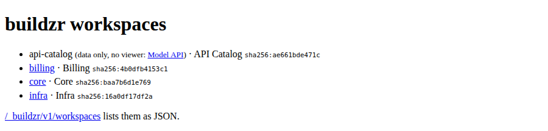

# `buildzr.yaml`

`buildzr.yaml` is the config file of your project. It holds what the `buildzr` commands need besides their options: where your workspaces folder is and the build settings. The file is optional; without it, the commands use the folder `workspaces` and the defaults.

This page is a reference. It lists where the commands look for the file, every key, how values are read, example files and the error messages. The options of each command are in the [Command reference](cli.md).

## Words used on this page

| Word | Meaning |
|---|---|
| **workspaces folder** | The folder of Python files that create your workspaces. The `workspaces:` key names it, or lists the files and folders to build instead. |
| **built workspace** | The folder that `buildzr build` writes for one workspace: the viewer, the model data and a file called `build.json`. |
| **build output** | The folder that holds every built workspace. The `build.out` key names it. |
| **data-only workspace** | A built workspace without the viewer, only the model data. |

## How the commands use this file

Each setting comes from the first of these that has it:

1. An option on the command line.
2. `buildzr.yaml`.
3. The built-in default.

When `workspaces:` is a list, an entry can set its own build settings, which come between the option and the `build:` section; see [Choosing which files to build](#choosing-which-files-to-build).

No environment variable sets a setting directly. You can use environment variables only inside the file, as [`${VAR}`](#values-from-environment-variables).

`buildzr build` and `buildzr serve` read the whole file, so a problem anywhere in it stops either command. `build` uses `workspaces` and `build`; it never uses `serve`. When you give `serve` a folder that already holds built workspaces, it uses only the `serve` settings of the file.

When the file has a problem, the command prints every problem, one per line, and exits with code 2. [Examples of error messages](#examples-of-error-messages) shows the format.

## Where the commands find the file

Without the `-c` option, a command looks for the file as follows:

- It starts in the current folder and walks up to the parent folders. The first `buildzr.yaml` it finds is used.
- It stops after the folder that contains `.git`, so it never reads a file outside your Git repository.
- The name must be exactly `buildzr.yaml`. If a folder has `buildzr.yml` or `.buildzr.yaml` and no `buildzr.yaml`, the search stops with `found buildzr.yml; the config file must be named buildzr.yaml`.

Relative paths in the file are relative to the folder that holds the file, not to the current folder. Without a file, the default folders `workspaces` and `.buildzr/build` are relative to the current folder.

## Keys

| Key | Type | Default | Meaning |
|---|---|---|---|
| `version` | integer | `1` | The version of the file format. Only `1` is accepted. |
| `workspaces` | text (path), or a list | `workspaces` | The workspaces folder. A path to a single `.py` file also works. Or a list of files and folders to build, each with its own build settings: see [Choosing which files to build](#choosing-which-files-to-build). `-w` on the command line replaces it. |
| `workspaces[].path` | text (path) | none | In a list: a `.py` file, or a folder whose Python files are all built. An entry that is only a path is the same as an entry with only `path`. |
| `workspaces[].build` | `k`, `text_color`, `viewer` | none | In a list: the build settings of this entry's workspaces. Each one wins over the same key of `build`. `out` is not allowed here. |
| `build.k` | whole number, at least 1 | `4` | Room for a box that contains other boxes, as a multiple of the area of an empty box; the same value as `--k`. See [Choosing a value for `--k`](cli.md#choosing-a-value-for-k). |
| `build.text_color` | `wcag` or `c4` | `wcag` | The text colour on boxes. See `--text-color` in [`buildzr build`](cli.md#buildzr-build). |
| `build.viewer` | `true` / `false` | `true` | `false` builds data-only workspaces. |
| `build.out` | text (path) | `.buildzr/build` | The build output: `build` writes one folder per workspace into it, and `serve` serves it. |
| `serve.public_url` | text (`http://` or `https://` URL) | none | The address at which readers reach the server, for example behind a proxy; the same value as `--public-url`. The links of the [Model API](model-api.md) (`viewerUrl`, `apiUrl`) start with it. A `/` at the end is dropped. Without it, the links start with `/`. |
| `serve.port` | whole number, 1 to 65535 | `8000` | The port `serve` listens on; the same value as `-p`/`--port`. |
| `serve.host` | text | `127.0.0.1` | The address `serve` listens on; the same value as `--host`. `127.0.0.1` lets only this machine connect. `0.0.0.0` shares the server with every machine on the network, and `serve` has no login, so set it only on purpose. |
| `serve.cors_origins` | list of text | `[]` | The web origins (`https://host[:port]`, no path, no `*`) whose pages may read the Model API from a browser; the same values as repeated `--cors-origin`. An empty list means none. `--cors-origin` on the command line **replaces** this list; it does not add to it. |

Unknown keys are errors. Secrets never go in this file: the keys `token`, `password` and `secret` are refused.

Keys of older versions are refused with a line that says what to do: `workspace` (use `workspaces`), and `targets` and `default_target` (`buildzr deploy` no longer exists).

To let your editor check the file, use the JSON Schema `buildzr/site/schema/config.schema.json`. Add `# yaml-language-server: $schema=<path or URL of the schema>` as the first line of the file.

## Values from environment variables

You can use environment variables in the text values `workspaces` (also each path of a list), `build.out`, `serve.public_url`, `serve.host` and each entry of `serve.cors_origins`. Not in `serve.port`, which is a number.

- Write `${NAME}`, where `NAME` matches `[A-Z_][A-Z0-9_]*`. Write `${NAME:-fallback}` to use `fallback` when the variable is unset or empty. Write `$$` for a literal `$`. Any other `$` is an error.
- A variable that is unset or empty, and has no fallback, is an error.
- A value is expanded only when a command uses it.

## How the file is read

The file is YAML, read with stricter rules than most YAML tools use:

- Only `true`, `false`, `null`, plain decimal integers (`4`) and plain decimal numbers (`1.5`) are typed. Everything else is text, including `yes`, `no`, `on`, `off`, `y`, `n`, `0755`, `1:30` and dates. A key `on:` stays the text `on`.
- Types are checked, not converted: `k: "4"` is an error.
- Duplicate keys, anchors (`&a`), aliases (`*a`), `<<` merges and `!tags` are errors.
- All problems are listed at once, each as `buildzr.yaml:<line>: <key>: <message>`.

## Example files

A project whose models live in another folder:

```yaml
workspaces: architecture
```

A project that builds data-only workspaces, with more room for boxes that contain other boxes, into a folder named after the Git branch:

```yaml
version: 1
workspaces: architecture
build:
  k: 9
  viewer: false
  out: "public/${BRANCH:-main}"
```

Settings for `buildzr serve` on a shared machine behind a proxy. Each one is used only when its option is not given on the command line. Set `public_url` in the file when the same project is served at a different address in each environment, such as a preview per branch: the variable gives the address, so the command stays the same everywhere.

```yaml
serve:
  public_url: "https://${PREVIEW_HOST:-architecture.example.com}"
  port: 8080
  host: 0.0.0.0
  cors_origins:
    - https://dashboard.example.com
```

## A project with several workspace files

A project can keep many model files in its workspaces folder, and one file can create several workspaces. This project has three workspaces in two files, and a helper file that both of them import. [Serve your workspaces](serve-workspaces.md) builds and serves the same project step by step.

```text
my-project/
├── buildzr.yaml
└── architecture/
    ├── _shared.py      a helper: never built on its own
    ├── billing.py      creates the workspace Billing
    └── platform.py     creates the workspaces Core and Infra
```

`buildzr.yaml` names the workspaces folder:

```yaml
workspaces: architecture
```

`architecture/_shared.py` holds a name that both model files use:

<!-- doctest: file architecture/_shared.py -->
```python
"""Names that several model files use. Files whose name starts with _ are never built on their own."""

PAYMENT_PROVIDER = "Payment Provider"
```

`architecture/billing.py` creates one workspace:

<!-- doctest: file architecture/billing.py -->
```python
from buildzr.dsl import Workspace, SoftwareSystem
from _shared import PAYMENT_PROVIDER

with Workspace("Billing") as w:
    invoicing = SoftwareSystem("Invoicing")
    payments = SoftwareSystem(PAYMENT_PROVIDER)
    invoicing >> "Collects payments through" >> payments
```

`architecture/platform.py` creates two:

<!-- doctest: file architecture/platform.py -->
```python
from buildzr.dsl import Workspace, Person, SoftwareSystem
from _shared import PAYMENT_PROVIDER

with Workspace("Core") as core:
    customer = Person("Customer")
    shop = SoftwareSystem("Web Shop")
    payments = SoftwareSystem(PAYMENT_PROVIDER)
    customer >> "Buys from" >> shop
    shop >> "Takes payments through" >> payments

with Workspace("Infra") as infra:
    cluster = SoftwareSystem("Kubernetes Cluster")
    database = SoftwareSystem("Database Service")
    cluster >> "Stores data in" >> database
```

Build the project. Every workspace of every file gets its own built workspace:

```text
$ buildzr build
built .buildzr/build/billing (2 elements, 1 relationship, 0 views; modelHash sha256:4b0dfb4153c1…)
built .buildzr/build/core (3 elements, 2 relationships, 0 views; modelHash sha256:baa7b6d1e769…)
built .buildzr/build/infra (2 elements, 1 relationship, 0 views; modelHash sha256:16a0df17df2a…)
```

The build output then holds one folder per workspace:

```text
.buildzr/build/
├── billing/    build.json, index.html, assets/, data/
├── core/       build.json, index.html, assets/, data/
└── infra/      build.json, index.html, assets/, data/
```

`buildzr serve` finds all three up to date and serves each one at its own address:

```text
$ buildzr serve
up to date: billing, core, infra
Serving .buildzr/build at http://127.0.0.1:8000/ (Ctrl+C to stop)
  http://127.0.0.1:8000/billing/
  http://127.0.0.1:8000/core/
  http://127.0.0.1:8000/infra/
Workspace list at http://127.0.0.1:8000/_buildzr/v1/workspaces
```

What to know about such a project:

- **Folder names come from workspace names**, not from file names: `Workspace("Core")` in `platform.py` becomes `core`, at `/core/`. The [naming rule](cli.md#the-name-of-a-built-workspace) lowers the case and replaces spaces and other characters with `-`.
- **Two workspaces with the same name stop the build** before anything is written. If `architecture/legacy.py` also created `Workspace("billing")`, `build` would print, with the full path of your workspaces folder:

    ```text
    buildzr: error: two workspaces would both be built as "billing": "Billing" in billing.py and "billing" in legacy.py (paths in /home/me/my-project/architecture); rename one of them
    ```

- **`-w` with one file builds only that file** and removes nothing, not even the built workspaces of files you deleted:

    ```text
    $ buildzr build -w architecture/billing.py
    built .buildzr/build/billing (2 elements, 1 relationship, 0 views; modelHash sha256:4b0dfb4153c1…)
    ```

- **A change to a helper makes every workspace out of date.** Files whose name starts with `_` are part of the fingerprint of every workspace, because any model file may import them. After this change to `_shared.py`, `serve` builds all three again:

    <!-- doctest: file architecture/_shared.py -->
    ```python
    """Names that several model files use. Files whose name starts with _ are never built on their own."""

    PAYMENT_PROVIDER = "Payment Provider"
    CURRENCY = "EUR"
    ```

    ```text
    $ buildzr serve
    built .buildzr/build/billing (2 elements, 1 relationship, 0 views; modelHash sha256:4b0dfb4153c1…)
    built .buildzr/build/core (3 elements, 2 relationships, 0 views; modelHash sha256:baa7b6d1e769…)
    built .buildzr/build/infra (2 elements, 1 relationship, 0 views; modelHash sha256:16a0df17df2a…)
    Serving .buildzr/build at http://127.0.0.1:8000/ (Ctrl+C to stop)
      http://127.0.0.1:8000/billing/
      http://127.0.0.1:8000/core/
      http://127.0.0.1:8000/infra/
    Workspace list at http://127.0.0.1:8000/_buildzr/v1/workspaces
    ```

    The modelHash of each workspace stays the same, because the models did not change.

- **A broken file breaks only its own workspaces.** With a typo in the last line of `platform.py`, Core and Infra are broken and Billing is built as usual. The build exits with code 1:

    <!-- doctest: file architecture/platform.py -->
    ```python
    from buildzr.dsl import Workspace, Person, SoftwareSystem
    from _shared import PAYMENT_PROVIDER

    with Workspace("Core") as core:
        customer = Person("Customer")
        shop = SoftwareSystem("Web Shop")
        payments = SoftwareSystem(PAYMENT_PROVIDER)
        customer >> "Buys from" >> shop
        shop >> "Takes payments through" >> payments

    with Workspace("Infra") as infra:
        cluster = SoftwareSystem("Kubernetes Cluster")
        database = SoftwareSystem("Database Service")
        cluster >> "Stores data in" >> databse
    ```

    ```text
    $ buildzr build
    ...
    NameError: name 'databse' is not defined
    built .buildzr/build/billing (2 elements, 1 relationship, 0 views; modelHash sha256:4b0dfb4153c1…)
    buildzr: BROKEN: workspace core (architecture/platform.py) failed at the model step
        NameError: name 'databse' is not defined
        platform.py, line 14: cluster >> "Stores data in" >> databse
      this workspace is broken; the viewer says so
    buildzr: BROKEN: workspace infra (architecture/platform.py) failed at the model step
        NameError: name 'databse' is not defined
        platform.py, line 14: cluster >> "Stores data in" >> databse
      this workspace is broken; the viewer says so
    [exit code 1]
    ```

    Core is broken too, although the error is in the part that creates Infra: when a file fails, none of its workspaces can be trusted. `serve` lists the broken workspaces next to the good one, and the list for programs gives each one its `status`:

    <!-- doctest: api page shape -->
    ```http
    GET /_buildzr/v1/workspaces
    ```

    ```json
    {
      "apiVersion": "1",
      "workspaces": [
        {
          "name": "billing",
          "path": "/billing/",
          "workspaceName": "Billing",
          "status": "ok",
          "viewerUrl": "/billing/",
          "apiUrl": "/billing/api/v1/",
          "llmsUrl": "/billing/llms.txt",
          "modelHash": "sha256:4b0dfb4153c1e2f16f2d94c116fc6c70c705b5935e51069616ec8f3e30feac0b",
          "builtAt": "2026-10-18T16:45:54Z",
          "source": "billing.py"
        },
        {
          "name": "core",
          "path": "/core/",
          "workspaceName": "Core",
          "status": "broken",
          "viewerUrl": "/core/",
          "apiUrl": "/core/api/v1/",
          "llmsUrl": "/core/llms.txt",
          "modelHash": null,
          "builtAt": "2026-10-18T16:45:54Z",
          "source": "platform.py",
          "stage": "model",
          "errors": [
            "NameError: name 'databse' is not defined",
            "platform.py, line 14: cluster >> \"Stores data in\" >> databse"
          ]
        },
        {
          "name": "infra",
          "path": "/infra/",
          "workspaceName": "Infra",
          "status": "broken",
          "viewerUrl": "/infra/",
          "apiUrl": "/infra/api/v1/",
          "llmsUrl": "/infra/llms.txt",
          "modelHash": null,
          "builtAt": "2026-10-18T16:45:54Z",
          "source": "platform.py",
          "stage": "model",
          "errors": [
            "NameError: name 'databse' is not defined",
            "platform.py, line 14: cluster >> \"Stores data in\" >> databse"
          ]
        }
      ]
    }
    ```

    Fix the typo and build again: all three are ok. [When a workspace is broken](cli.md#when-a-workspace-is-broken) has the details.

    <!-- doctest: file architecture/platform.py -->
    ```python
    from buildzr.dsl import Workspace, Person, SoftwareSystem
    from _shared import PAYMENT_PROVIDER

    with Workspace("Core") as core:
        customer = Person("Customer")
        shop = SoftwareSystem("Web Shop")
        payments = SoftwareSystem(PAYMENT_PROVIDER)
        customer >> "Buys from" >> shop
        shop >> "Takes payments through" >> payments

    with Workspace("Infra") as infra:
        cluster = SoftwareSystem("Kubernetes Cluster")
        database = SoftwareSystem("Database Service")
        cluster >> "Stores data in" >> database
    ```

    ```text
    $ buildzr build
    built .buildzr/build/billing (2 elements, 1 relationship, 0 views; modelHash sha256:4b0dfb4153c1…)
    built .buildzr/build/core (3 elements, 2 relationships, 0 views; modelHash sha256:baa7b6d1e769…)
    built .buildzr/build/infra (2 elements, 1 relationship, 0 views; modelHash sha256:16a0df17df2a…)
    ```

## Choosing which files to build

With `workspaces: architecture`, every model file of the folder is built, and every workspace gets the same build settings. To build only some files, or to give one file its own settings, make `workspaces:` a list of files and folders.

This continues the project above. The team adds `architecture/api_catalog.py`, a list of the services and their APIs that scripts and AI assistants read through the [Model API](model-api.md). Nobody looks at it in a browser, so it needs no viewer:

<!-- doctest: file architecture/api_catalog.py -->
```python
from buildzr.dsl import Workspace, SoftwareSystem
from _shared import PAYMENT_PROVIDER

with Workspace("API Catalog") as w:
    orders = SoftwareSystem("Orders API", "REST, owned by the shop team")
    invoices = SoftwareSystem("Invoices API", "REST, owned by the billing team")
    payments = SoftwareSystem(PAYMENT_PROVIDER, "External")
    orders >> "Asks for an invoice through" >> invoices
    invoices >> "Collects payments through" >> payments
```

```text
my-project/
├── buildzr.yaml
└── architecture/
    ├── _shared.py
    ├── api_catalog.py  creates the workspace API Catalog
    ├── billing.py      creates the workspace Billing
    └── platform.py     creates the workspaces Core and Infra
```

This `buildzr.yaml` lists the three model files. Platform diagrams have systems inside other systems, so `platform.py` gets more room for them (`k: 9`); the catalog is built without the viewer:

```yaml
build:
  k: 4
workspaces:
  - architecture/billing.py
  - path: architecture/platform.py
    build:
      k: 9
  - path: architecture/api_catalog.py
    build:
      viewer: false
```

Each entry is a path, or a mapping with `path` and an optional `build` that holds `k`, `text_color` or `viewer`. The `built` line of a workspace shows the settings that are not the defaults:

```text
$ buildzr build
built .buildzr/build/billing (2 elements, 1 relationship, 0 views; modelHash sha256:4b0dfb4153c1…)
built .buildzr/build/core (k 9; 3 elements, 2 relationships, 0 views; modelHash sha256:baa7b6d1e769…)
built .buildzr/build/infra (k 9; 2 elements, 1 relationship, 0 views; modelHash sha256:16a0df17df2a…)
built .buildzr/build/api-catalog (data only; 3 elements, 2 relationships, 0 views; modelHash sha256:ae661bde471c…)
```

`serve` serves the data-only workspace like the others, but gives the address of its Model API instead of a viewer:

```text
$ buildzr serve
up to date: api-catalog, billing, core, infra
Serving .buildzr/build at http://127.0.0.1:8000/ (Ctrl+C to stop)
  http://127.0.0.1:8000/api-catalog/api/v1/ (data only, no viewer)
  http://127.0.0.1:8000/billing/
  http://127.0.0.1:8000/core/
  http://127.0.0.1:8000/infra/
Workspace list at http://127.0.0.1:8000/_buildzr/v1/workspaces
```

The index page at `http://127.0.0.1:8000/` links the Model API of the catalog, and in the workspace list for programs its `viewerUrl` is `null`.



*The index page with the data-only workspace api-catalog: it has no viewer link.*

How a list works:

- **Only the listed files are built.** A model file in `architecture` that is not on the list is not built. Paths are relative to the folder that holds `buildzr.yaml`, and they may use [environment variables](#values-from-environment-variables).
- **A folder entry builds every model file in it**, as a workspaces folder does: its subfolders too, and not the files and folders whose name starts with `_` or `.`. Its `build` settings apply to each of those files:

    ```yaml
    workspaces:
      - architecture/billing.py
      - path: shared-models/
        build:
          text_color: c4
    ```

    A folder entry that holds no model file prints a warning and builds nothing; the other entries are built as usual.

- **Each setting of a workspace comes from the first of these that has it:**
    1. An option on the command line: `--k`, `--text-color`, `--no-viewer`.
    2. The `build` of the file's entry.
    3. The `build` section of the file.
    4. The built-in default.
- **`-w` replaces the list.** `buildzr build -w architecture/platform.py` builds that file with the settings of the `build` section, so with `k` 4, not 9. To build one file with the settings of its entry, run `buildzr build` without `-w`.
- **A change to one entry rebuilds only its workspaces.** The settings of each workspace are part of its fingerprint. Change `k: 9` to `k: 12`, and `serve` builds Core and Infra again and finds Billing and API Catalog up to date. A helper file counts for the files of the folder that holds it: here `_shared.py` counts for all three, because they are all in `architecture`.
- **Taking a file off the list removes its built workspace on the next full build**, as deleting the file does with a workspaces folder. Without the `api_catalog.py` entry:

    ```yaml
    build:
      k: 4
    workspaces:
      - architecture/billing.py
      - path: architecture/platform.py
        build:
          k: 9
    ```

    ```text
    $ buildzr build
    built .buildzr/build/billing (2 elements, 1 relationship, 0 views; modelHash sha256:4b0dfb4153c1…)
    built .buildzr/build/core (k 9; 3 elements, 2 relationships, 0 views; modelHash sha256:baa7b6d1e769…)
    built .buildzr/build/infra (k 9; 2 elements, 1 relationship, 0 views; modelHash sha256:16a0df17df2a…)
    removed api-catalog: its model file architecture/api_catalog.py is no longer in the workspaces: list
    ```

    `buildzr build -w FILE` and `serve` never remove anything. A build removes only the workspaces it built itself: `build.json` records the config file of the list, so a build of another config file, or of a single path with `-w`, never removes the workspaces of this list.

- **A path that does not exist stops the command** before anything is built, with the line of the entry. With a typo in the first entry:

    ```yaml
    workspaces:
      - architecture/biling.py
      - architecture/platform.py
    ```

    ```text
    $ buildzr build
    buildzr.yaml:2: workspaces[0]: architecture/biling.py not found (relative to buildzr.yaml's folder)
    [exit code 2]
    ```

    Entries are counted from 0: `workspaces[0]` is the first one.

- **A file may be on the list only once**, also through a folder entry. Both entries are named:

    ```yaml
    workspaces:
      - architecture/platform.py
      - path: architecture
        build:
          k: 9
    ```

    ```text
    $ buildzr build
    buildzr.yaml:3: workspaces[1]: architecture holds architecture/platform.py, which is already in workspaces[0] (line 2); list each file once
    [exit code 2]
    ```

    An empty list (`workspaces: []`) is an error too.

## Examples of error messages

Each message names the line of the file and the key it is about.

A value of the wrong type:

<!-- doctest: invalid -->
```yaml
workspaces: architecture
build:
  k: four
```

```text
buildzr.yaml:3: build.k: expected a whole number of at least 1, got the text "four"
```

A secret in the file. The message tells you where to keep it instead:

<!-- doctest: invalid -->
```yaml
workspaces: architecture
build:
  token: abc123
```

```text
buildzr.yaml:3: build: unknown key "token". Secrets never go in this file; keep them in an environment variable.
```

A file written for an older version:

<!-- doctest: invalid -->
```yaml
workspace: architecture/model.py
targets:
  www: {dir: /var/www/architecture}
```

```text
buildzr.yaml:1: workspace: removed: use workspaces: (a folder; a single .py file path also works)
buildzr.yaml:2: targets: removed: buildzr deploy no longer exists; delete this key
```

An environment variable that is not set. This uses the second example file above, with `out: "public/${BRANCH}"` and no fallback:

```yaml
workspaces: architecture
build:
  out: "public/${BRANCH}"
```

```text
$ buildzr build
buildzr.yaml:3: build.out: environment variable BRANCH is not set (used in "public/${BRANCH}")
[exit code 2]
```

The last line of each command example, such as `[exit code 2]`, shows the exit code. The command does not print it.

## Python functions

The module `buildzr.site.config` has these functions for scripts and tests: `find_config(start)`, `load_config(path)`, `resolve_workspaces(cfg, env)`, `resolve_workspace_entries(cfg, env)` (a list of `workspaces:`, or `None`), `workspace_files(cfg, entries)` (the model files of each entry; it checks that they exist and are listed once), `resolve_build(cfg, env)` and `resolve_serve(cfg, env)`. Problems raise `ConfigError`. `load_config` does not read environment variables; the `resolve_*` functions do.
