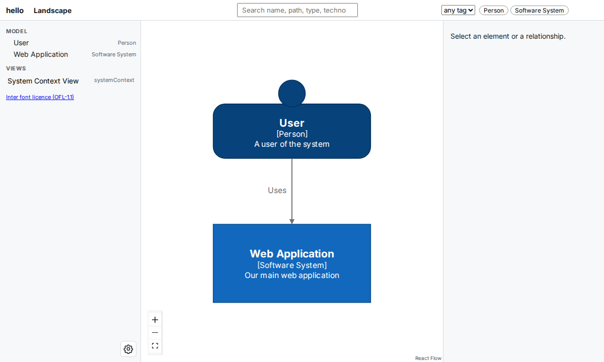
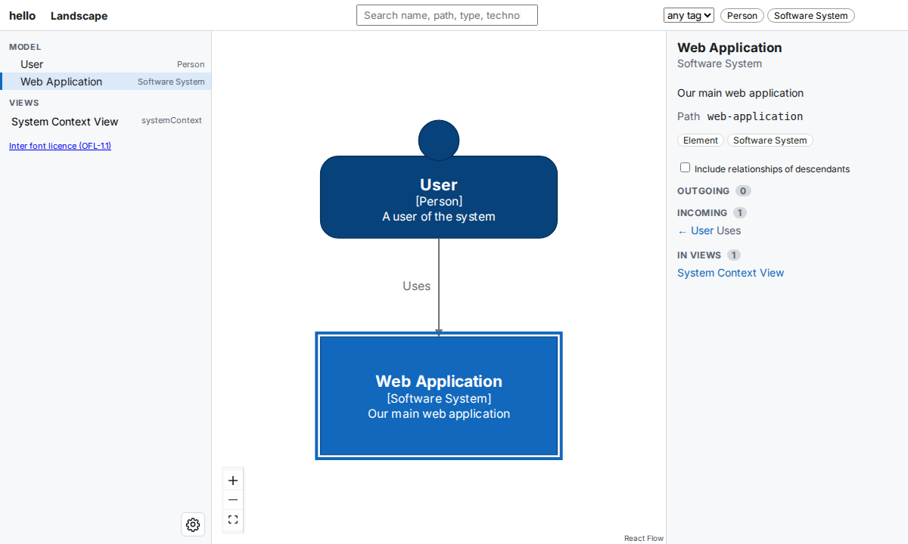
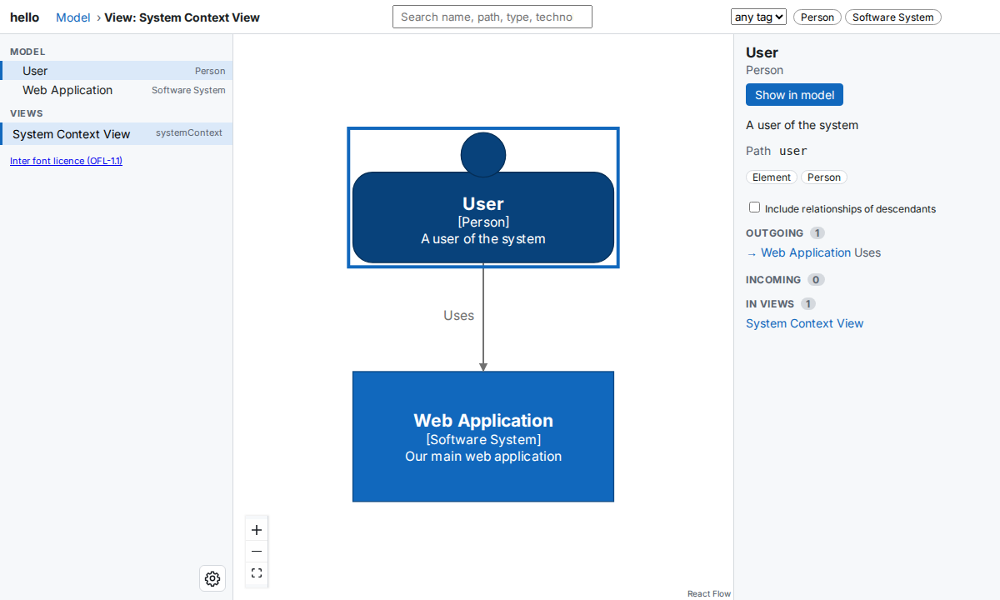

# Quick Start

In this tutorial, you describe a small software system in Python and open its diagram in your browser with `buildzr serve`, which builds the model and serves it in one step. At the end, you have a working model file and a diagram that you can click through.

!!! tip "Try it in your browser first"
    The [complete example](#6-compare-your-file-with-the-complete-example) on this page has a **Run Code** button. It runs the model in your browser, without installing anything, and shows the model as JSON (the Structurizr workspace format). You do not need it for the tutorial.

## Before you start

You need:

- Python 3.11 or newer.
- Node.js 18 or newer. The layout step of `buildzr build` runs on Node. Check your version with `node --version`.
- [uv](https://docs.astral.sh/uv/getting-started/installation/), the Python package manager that this tutorial uses.

## 1. Create a project and install buildzr

Create a project folder, add buildzr to it, activate its virtual environment, and create a folder called `workspaces`:

```bash
uv init quickstart
cd quickstart
uv add buildzr
source .venv/bin/activate
mkdir workspaces
```

On Windows, activate the environment with `.venv\Scripts\activate` instead. The `buildzr` command is now available in this terminal.

The `workspaces` folder is where the `buildzr` command looks for your models. Each Python file in it describes one or more workspaces.

!!! note "With pip, or without installing"
    With pip instead of uv: create and activate a virtual environment, then run `pip install buildzr`.

    You can also run the commands of this tutorial without installing buildzr, by putting `uvx` in front of them (`uvx buildzr serve`). This tutorial installs buildzr anyway, because your editor needs it to understand the model file while you write it.

## 2. Start the model file

The **model file** is a Python file that describes your architecture. Create a file called `hello.py` in the `workspaces` folder, with this content:

<!-- doctest: file workspaces/hello.py -->
```python
# no-run: a step; the complete example at the end of the page runs
from buildzr.dsl import (
    Workspace,
    SoftwareSystem,
    Person,
    StyleElements,
    SystemContextView,
)

with Workspace('hello') as w:
    pass
```

The first lines import what this tutorial uses from `buildzr.dsl`. `Workspace` holds your whole model: everything else in this tutorial goes inside the `with` block, in place of `pass`. Its name, `hello`, becomes part of the address at which you open the diagrams.

## 3. Add a person, a system and a relationship

Replace `pass` with a person, a software system, and a relationship between them. The new lines are highlighted:

<!-- doctest: file workspaces/hello.py -->
```python hl_lines="11-17"
# no-run: a step; the complete example at the end of the page runs
from buildzr.dsl import (
    Workspace,
    SoftwareSystem,
    Person,
    StyleElements,
    SystemContextView,
)

with Workspace('hello') as w:
    user = Person('User', description='A user of the system')
    system = SoftwareSystem(
        'Web Application',
        description='Our main web application'
    )

    user >> "Uses" >> system
```

The line `user >> "Uses" >> system` says that the user uses the web application. "Uses" becomes the label of the arrow.

## 4. Give the person a person shape

Add a style that draws the user with the `Person` shape:

<!-- doctest: file workspaces/hello.py -->
```python hl_lines="19-22"
# no-run: a step; the complete example at the end of the page runs
from buildzr.dsl import (
    Workspace,
    SoftwareSystem,
    Person,
    StyleElements,
    SystemContextView,
)

with Workspace('hello') as w:
    user = Person('User', description='A user of the system')
    system = SoftwareSystem(
        'Web Application',
        description='Our main web application'
    )

    user >> "Uses" >> system

    StyleElements(
        on=[user],
        shape='Person'
    )
```

## 5. Add a view

A **view** is a diagram that you choose to draw. Add a system context view of the web application: it shows the system and the people and systems around it.

<!-- doctest: file workspaces/hello.py -->
```python hl_lines="24-29"
# no-run: a step; the complete example at the end of the page runs
from buildzr.dsl import (
    Workspace,
    SoftwareSystem,
    Person,
    StyleElements,
    SystemContextView,
)

with Workspace('hello') as w:
    user = Person('User', description='A user of the system')
    system = SoftwareSystem(
        'Web Application',
        description='Our main web application'
    )

    user >> "Uses" >> system

    StyleElements(
        on=[user],
        shape='Person'
    )

    SystemContextView(
        software_system_selector=system,
        key='system-context',
        description='System Context View',
        auto_layout='tb'
    )
```

`key='system-context'` names the view; you use the name in a link in step 9. `auto_layout='tb'` asks Structurizr tools to lay the view out from top to bottom.

## 6. Compare your file with the complete example

Your `workspaces/hello.py` is now complete. It must look like this:

<!-- doctest: file workspaces/hello.py -->
```python
from buildzr.dsl import (
    Workspace,
    SoftwareSystem,
    Person,
    StyleElements,
    SystemContextView,
)

with Workspace('hello') as w:
    user = Person('User', description='A user of the system')
    system = SoftwareSystem(
        'Web Application',
        description='Our main web application'
    )

    user >> "Uses" >> system

    StyleElements(
        on=[user],
        shape='Person'
    )

    SystemContextView(
        software_system_selector=system,
        key='system-context',
        description='System Context View',
        auto_layout='tb'
    )
```

The file does not call `w.save()`. In the next step, `buildzr serve` runs the file and reads the workspace itself.

## 7. Build and serve the workspace

In the `quickstart` folder, start `buildzr serve`:

```text
$ buildzr serve
built .buildzr/build/hello (2 elements, 1 relationship, 1 view; modelHash sha256:de1cb536d351…)
Serving .buildzr/build at http://127.0.0.1:8000/ (Ctrl+C to stop)
  http://127.0.0.1:8000/hello/
Workspace list at http://127.0.0.1:8000/_buildzr/v1/workspaces
```

`buildzr serve` did two things:

1. It **built** your workspace. It ran every Python file in `workspaces`, laid out the diagrams of the workspace that `hello.py` creates, and wrote the result to the folder `.buildzr/build/hello`: the web pages that draw your diagrams. The `built` line counts what your model contains: 2 elements (the user and the web application), 1 relationship and 1 view.
2. It **serves** that folder at `http://127.0.0.1:8000/`. Each workspace has its own address, made from its name: `/hello/`.

The next time you start `buildzr serve`, it builds only the workspaces whose model file changed. It prints `up to date: hello` for the others.

## 8. Open the workspace in your browser

Open `http://127.0.0.1:8000/` in your browser. Because you have one workspace, the browser goes on to `http://127.0.0.1:8000/hello/`. You see the **landscape**: every person and software system of your model, like a [System Landscape diagram](https://c4model.com/#SystemLandscapeDiagram) of the C4 model. Here, that is the user, the web application and the "Uses" arrow between them.



*The first screen. The left panel lists the elements of the model and, under **Views**, your System Context View.*

Click the **Web Application** box. The right panel shows its details: its description, its path, the relationships that go in and out, and the views it appears in.



*After the click. Under **Incoming**, the panel shows the "Uses" relationship from the User.*

## 9. Open a link to one element

Every screen of the viewer has its own address. Open this address in your browser:

```
http://127.0.0.1:8000/hello/#/v/system-context?sel=user
```

The viewer opens the System Context View that you added in step 5, with the User selected. You can share such a link with anyone who can open the workspace.



*The view opened from the link. The top bar shows **View: System Context View**, and the right panel shows the User.*

To stop `buildzr serve`, press Ctrl+C in the terminal.

## 10. Build without serving

`buildzr build` does the first half of `buildzr serve`: it builds every workspace of the `workspaces` folder and stops. Use it when you want the built files only, for example to copy them to another machine:

```text
$ buildzr build
built .buildzr/build/hello (2 elements, 1 relationship, 1 view; modelHash sha256:de1cb536d351…)
```

Unlike `buildzr serve`, `buildzr build` always builds every workspace again.

## Next steps

You have written a model file, built it into a workspace and opened its diagrams. From here:

- Learn how to describe more: [Core Concepts](../user-guide/core-concepts.md), [Models](../user-guide/models.md), [Relationships](../user-guide/relationships.md) and [Views](../user-guide/views.md).
- Serve several workspaces, and let other people open them: [Serve your workspaces](../serve-workspaces.md).
- Look up every option of `build`, `export` and `serve`: [Command reference](../cli.md).
- Let scripts and AI assistants read your model as JSON: [The Model API](../model-api.md).

### Other ways to view the model

The viewer is the main way to view a buildzr model, but the model is also a standard Structurizr workspace in JSON. To write it to a file, run `buildzr export workspaces/hello.py --pretty`, which writes `export/<workspace name>/workspace.json`. Then you can open it with other tools:

- **[Structurizr Lite](https://docs.structurizr.com/lite)** shows the workspace in your browser. Run it in the folder that holds `workspace.json` (for example `export/hello`):

    ```bash
    docker run -it --rm -p 8080:8080 -v $PWD:/usr/local/structurizr structurizr/lite
    ```

- **[Structurizr CLI](https://docs.structurizr.com/cli)** converts the workspace to other formats, such as PlantUML and Mermaid.
- **PlantUML**: `buildzr export workspaces/hello.py -f plantuml -o output` writes `.puml` files. It needs `pip install "buildzr[export-plantuml]"` and Java 11 or newer. Open the files with a [C4-PlantUML](https://github.com/plantuml-stdlib/C4-PlantUML) viewer, for example the [PlantUML web editor](https://www.plantuml.com/plantuml/uml/ZOvFIyGm4CNl-HIrfowupSMJfvNrk6BnprccwT069fEGcI3zzhO5YoAAf_VcmVlDEub2rXB8N7bsL0Qi9jKajzPcU6z7hrFfYs1saHLPMnU3JGIyTewY0_dUdc-EtHgzFbni057CI_HsNXhW6NERLhxfC4la9croHnxakgelq2FLYtbCwYC3LVSeBlljgWzcXpJkq_selg2RE58Svpz0pxCeXaOs-UztyuJqVV3lAtR4bpa7Sq8UIg0F). See the [Export](../user-guide/export.md) page.
