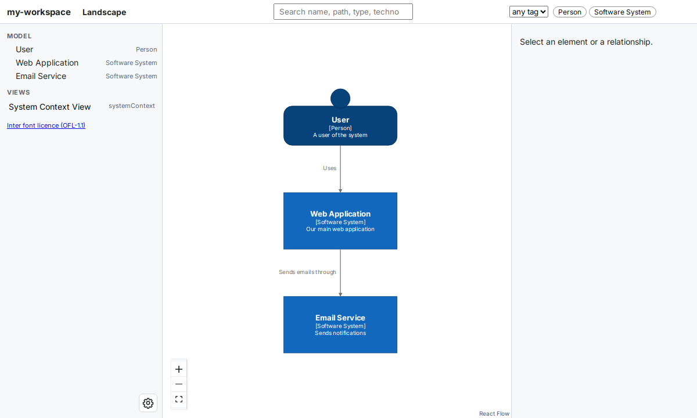

# Publish your first site

In this tutorial, you publish the model from the [Quick Start](getting-started/quick-start.md) to an instance on your own machine, open the published site, deploy a change and roll it back. An **instance** is a running `buildzr serve` that holds the sites that people deploy to it. At the end, you know every step of a deploy; putting the instance on a real server only changes where it runs.

## Before you start

You need:

- The `quickstart` project from the [Quick Start](getting-started/quick-start.md), with its virtual environment active. Your `model.py` looks like this:

<!-- doctest: file model.py -->
```python
from buildzr.dsl import (
    Workspace,
    SoftwareSystem,
    Person,
    StyleElements,
    SystemContextView,
)

with Workspace('my-workspace') as w:
    user = Person('User', description='A user of the system')
    system = SoftwareSystem(
        'Web Application',
        description='Our main web application'
    )

    user >> "Uses" >> system

    StyleElements(
        on=[user],
        shape='Person'
    )

    SystemContextView(
        software_system_selector=system,
        key='system-context',
        description='System Context View',
        auto_layout='tb'
    )
```

- The `serve` extra of buildzr, which the instance needs to check every site it receives. In the `quickstart` folder, run:

    ```bash
    uv add 'buildzr[serve]'
    ```

- Linux or macOS. On Windows, use WSL (Windows Subsystem for Linux).
- Two terminals, both in the `quickstart` folder with the virtual environment active.

## 1. Start an instance

In the **second** terminal, start an instance that keeps its sites in the folder `buildzr-store` and accepts deploys:

```text
$ buildzr serve --store buildzr-store --accept-deploys
Serving store /home/you/quickstart/buildzr-store (0 sites) at http://127.0.0.1:8000/ (read only)
Accepting deploys at http://127.0.0.1:8001/ (this machine only; no authentication)
```

The instance listens on two ports. Readers open the sites on port 8000. `buildzr deploy` sends new sites to port 8001, the **deploy listener**, which only this machine can reach.

Leave the instance running, and continue in the first terminal.

## 2. Add a target to `buildzr.yaml`

A **target** tells `buildzr deploy` where to send the site. In the `quickstart` folder, create the file `buildzr.yaml` with this content:

```yaml
workspace: model.py
targets:
  local: {url: "http://127.0.0.1:8001"}
```

`workspace` names your model file, so that you no longer type `-w model.py`. The target `local` points to the deploy listener of your instance. It is the only target, so `deploy` uses it without `-t`.

## 3. Check the deploy with a dry run

A dry run builds the site, checks it and packs it, but sends nothing:

```text
$ buildzr deploy --dry-run
built (2 elements, 1 relationship, 1 view; modelHash sha256:de1cb536d351…)
packed 11 files, 512 KB (191 KB compressed)
dry run: would upload 11 files, 512 KB to http://127.0.0.1:8001 (the root site); nothing was sent
```

"The root site" means that the site goes to the top address of the instance, `/`.

## 4. Deploy the site

```text
$ buildzr deploy
built (2 elements, 1 relationship, 1 view; modelHash sha256:de1cb536d351…)
uploading 11 files, 512 KB to http://127.0.0.1:8001 (the root site)
deployed /: release r-0001, modelHash sha256:de1cb536d351…
open: http://127.0.0.1:8000/
api:  http://127.0.0.1:8000/api/v1/
```

The instance has stored your site as **release** `r-0001`. The `open:` line is the link to the published site.

## 5. Open the published site

Open `http://127.0.0.1:8000/` in your browser. You see the same diagram as at the end of the Quick Start, but now the instance serves it: anyone who can reach port 8000 of this machine sees the same site.

## 6. Deploy a change

Add an email service to `model.py`. The new lines are highlighted:

<!-- doctest: file model.py -->
```python hl_lines="15-18 21"
from buildzr.dsl import (
    Workspace,
    SoftwareSystem,
    Person,
    StyleElements,
    SystemContextView,
)

with Workspace('my-workspace') as w:
    user = Person('User', description='A user of the system')
    system = SoftwareSystem(
        'Web Application',
        description='Our main web application'
    )
    email = SoftwareSystem(
        'Email Service',
        description='Sends notifications'
    )

    user >> "Uses" >> system
    system >> "Sends emails through" >> email

    StyleElements(
        on=[user],
        shape='Person'
    )

    SystemContextView(
        software_system_selector=system,
        key='system-context',
        description='System Context View',
        auto_layout='tb'
    )
```

Deploy again:

```text
$ buildzr deploy
built (3 elements, 2 relationships, 1 view; modelHash sha256:ca6baba767f5…)
uploading 11 files, 514 KB to http://127.0.0.1:8001 (the root site)
deployed /: release r-0002, modelHash sha256:ca6baba767f5… (previous sha256:de1cb536d351…)
open: http://127.0.0.1:8000/
api:  http://127.0.0.1:8000/api/v1/
```

The new release is `r-0002`, and the line names the modelHash of the release it replaced. Reload the page in your browser: the Email Service is there.



*The site after the second deploy. The left panel lists the new Email Service.*

## 7. Roll back the change

Suppose the change was a mistake. Make the previous release current again:

```text
$ buildzr deploy --rollback
rolled back /: release r-0001 is current again, modelHash sha256:de1cb536d351… (was sha256:ca6baba767f5…)
open: http://127.0.0.1:8000/
api:  http://127.0.0.1:8000/api/v1/
```

Nothing was built or uploaded: the instance keeps the current and the previous release, and swapped them. Reload the page in your browser: the Email Service is gone. (A second rollback would swap them back.)

To stop the instance, press Ctrl+C in the second terminal.

## What you did

You started an instance, named it as a target in `buildzr.yaml`, deployed a site, deployed a change and rolled it back. From here:

- Run the instance on a server, so that other people can reach it, and deploy to it from your machine or from CI (continuous integration): [Deploying to an instance](deploy.md).
- Ready-made setups, such as a preview of every pull request: [Recipes](publishing-recipes.md).
- Every option of `build`, `serve` and `deploy`, and what `deploy` does with a folder target instead of an instance: [Command reference](cli.md).
- Every key of the config file: [`buildzr.yaml`](config.md).
