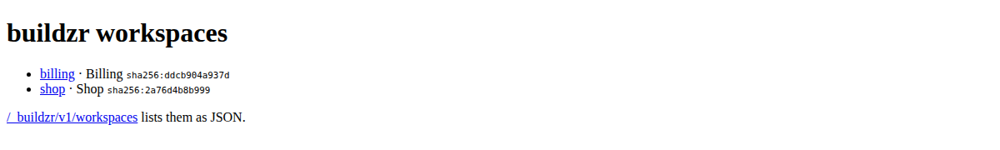
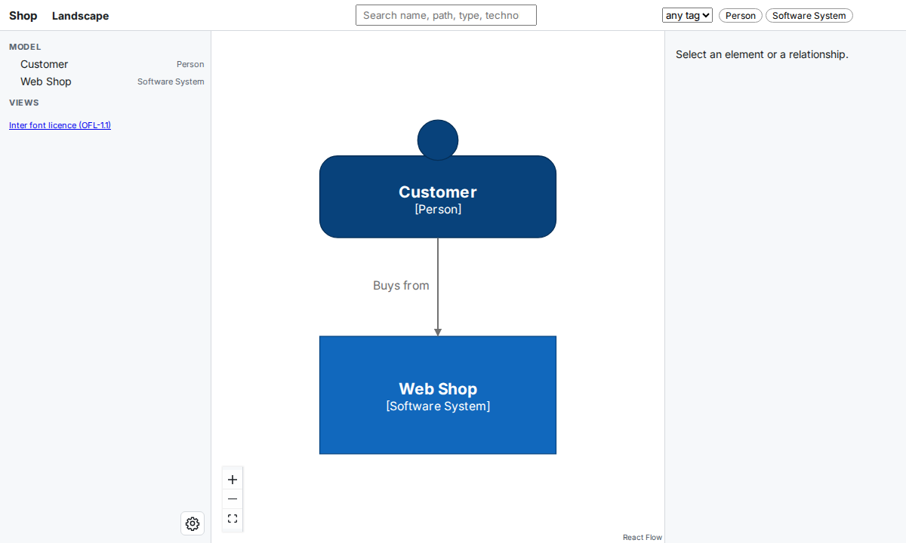

# Serve your workspaces

In this tutorial, you put two models in one workspaces folder and serve both with one `buildzr serve`. You open the page that lists them, change one model and see that only that one is built again, and learn the options for serving to other people. At the end, you know how `buildzr serve` decides what to build and where each workspace is.

## Before you start

You need:

- buildzr installed, as in step 1 of the [Quick Start](getting-started/quick-start.md). The Quick Start also shows what a single workspace looks like in the viewer.
- Node.js 18 or newer, for the layout step of the build. Check your version with `node --version`.

## Words used on this page

| Word | Meaning |
|---|---|
| **workspace** | A `Workspace(...)` that you write in Python, and what readers open at `/<name>/`: its viewer, its data and its Model API. |
| **workspaces folder** | The folder of Python files that create your workspaces. Here, it is `workspaces/`, the default. |
| **built workspace** | The folder that the build writes for one workspace: the viewer, the model data and `build.json`. |
| **build output** | The folder that holds every built workspace: `.buildzr/build`, the default. |

## 1. Create two model files

In an empty project folder, create a folder called `workspaces`. Save this file as `workspaces/shop.py`:

<!-- doctest: file workspaces/shop.py -->
```python
from buildzr.dsl import Workspace, Person, SoftwareSystem

with Workspace("Shop") as w:
    customer = Person("Customer")
    shop = SoftwareSystem("Web Shop")
    customer >> "Buys from" >> shop
```

Save this one as `workspaces/billing.py`:

<!-- doctest: file workspaces/billing.py -->
```python
from buildzr.dsl import Workspace, SoftwareSystem

with Workspace("Billing") as w:
    invoicing = SoftwareSystem("Invoicing")
    payments = SoftwareSystem("Payment Provider")
    invoicing >> "Collects payments through" >> payments
```

Each file creates one workspace. A file may also create several; each one is built and served on its own.

## 2. Start `buildzr serve`

In the project folder, run `buildzr serve`:

```text
$ buildzr serve
built .buildzr/build/billing (2 elements, 1 relationship, 0 views; modelHash sha256:2a3b8c4d5e6f…)
built .buildzr/build/shop (2 elements, 1 relationship, 0 views; modelHash sha256:7f1e2d3c4b5a…)
Serving .buildzr/build at http://127.0.0.1:8000/ (Ctrl+C to stop)
  http://127.0.0.1:8000/billing/
  http://127.0.0.1:8000/shop/
Workspace list at http://127.0.0.1:8000/_buildzr/v1/workspaces
```

Nothing was built yet, so `serve` built both workspaces first. Each one went to a folder of the build output named after the workspace: `Shop` became `shop` and `Billing` became `billing`. The [Command reference](cli.md#the-name-of-a-built-workspace) gives the full naming rule.

## 3. Open the list of workspaces

Open `http://127.0.0.1:8000/` in your browser. With more than one workspace, the page lists them, with a link to each:



*The page at `/`. Each line shows the address of a workspace, the name you gave it in Python and the start of its modelHash.*

Click **shop**. The viewer of the Shop workspace opens at `http://127.0.0.1:8000/shop/`:



*The Shop workspace at `/shop/`. Every workspace has its own viewer, its own data and its own [Model API](model-api.md), at `/shop/api/v1/`.*

With only one workspace, the page at `/` is not shown: the browser goes straight on to `/<name>/`, as in the Quick Start. The address `/` keeps working when you add a second workspace later, and then shows this list.

## 4. Change one model and serve again

Stop `buildzr serve` with Ctrl+C. Add a third system to `workspaces/billing.py`:

<!-- doctest: file workspaces/billing.py -->
```python hl_lines="6 8"
from buildzr.dsl import Workspace, SoftwareSystem

with Workspace("Billing") as w:
    invoicing = SoftwareSystem("Invoicing")
    payments = SoftwareSystem("Payment Provider")
    ledger = SoftwareSystem("Ledger")
    invoicing >> "Collects payments through" >> payments
    invoicing >> "Books invoices in" >> ledger
```

Start `buildzr serve` again:

```text
$ buildzr serve
up to date: shop
built .buildzr/build/billing (3 elements, 2 relationships, 0 views; modelHash sha256:9c8b7a6f5e4d…)
Serving .buildzr/build at http://127.0.0.1:8000/ (Ctrl+C to stop)
  http://127.0.0.1:8000/billing/
  http://127.0.0.1:8000/shop/
Workspace list at http://127.0.0.1:8000/_buildzr/v1/workspaces
```

Only Billing was built again. `serve` compares a **fingerprint** of each model file with the one recorded in the `build.json` of the built workspace. The fingerprint covers the model file, every file of the workspaces folder whose name starts with `_` (shared code), the version of buildzr and the build options. Shop did not change, so `serve` kept it.

The fingerprint does not cover code that a model file imports from outside the workspaces folder. If you change such code, use `--rebuild` (step 5).

If you delete a model file, or rename a workspace in one, `serve` keeps serving the old built workspace, because it never removes anything from the build output. Run `buildzr build`: a build of the whole workspaces folder removes the built workspaces that no model file creates any more, and prints a `removed` line for each.

You do not have to stop `buildzr serve` to see a change: run `buildzr build` in a second terminal, then reload the page. `serve` notices new and replaced workspaces on the next request.

## 5. Build nothing, or build everything

Two options change what `serve` builds:

- `--no-build` serves the build output as it is. Use it on a machine without Node, or when you only want to look.
- `--rebuild` builds every workspace again, whether it is up to date or not.

```text
$ buildzr serve --no-build
Serving .buildzr/build at http://127.0.0.1:8000/ (Ctrl+C to stop)
  http://127.0.0.1:8000/billing/
  http://127.0.0.1:8000/shop/
Workspace list at http://127.0.0.1:8000/_buildzr/v1/workspaces
```

```text
$ buildzr serve --rebuild
built .buildzr/build/billing (3 elements, 2 relationships, 0 views; modelHash sha256:9c8b7a6f5e4d…)
built .buildzr/build/shop (2 elements, 1 relationship, 0 views; modelHash sha256:7f1e2d3c4b5a…)
Serving .buildzr/build at http://127.0.0.1:8000/ (Ctrl+C to stop)
  http://127.0.0.1:8000/billing/
  http://127.0.0.1:8000/shop/
Workspace list at http://127.0.0.1:8000/_buildzr/v1/workspaces
```

You can also give `serve` a folder of built workspaces, for example one that a CI job built and you downloaded: `buildzr serve path/to/build`. `serve` then serves that folder as it is, and needs neither the model files nor Node.

## 6. List the workspaces from a program

A script, a dashboard or an AI assistant that knows only the address of the server can ask which workspaces it serves:

<!-- doctest: api page shape -->
```http
GET /_buildzr/v1/workspaces
```

```json
{
  "apiVersion": "1",
  "workspaces": [
    {
      "name": "billing",
      "path": "/billing/",
      "workspaceName": "Billing",
      "status": "ok",
      "viewerUrl": "/billing/",
      "apiUrl": "/billing/api/v1/",
      "llmsUrl": "/billing/llms.txt",
      "modelHash": "sha256:9c8b7a6f5e4d3c2b1a0f9e8d7c6b5a4f3e2d1c0b9a8f7e6d5c4b3a2f1e0d9c8b",
      "builtAt": "2026-10-18T14:15:02Z",
      "source": "billing.py"
    }
  ]
}
```

The answer above is shortened to its first workspace. Each entry has:

- `name` and `path`: the name of the built workspace and where it is served.
- `workspaceName`: the name you gave the `Workspace` in Python.
- `status`: `ok`, or `broken` when building the workspace failed. A broken entry also has `stage` and `errors` (the first 10); see [When a workspace is broken](#8-when-a-workspace-is-broken).
- `viewerUrl`: the address of its viewer, or `null` for a [data-only workspace](publishing-recipes.md#a-workspace-for-programs-only).
- `apiUrl` and `llmsUrl`: its [Model API](model-api.md) and its `llms.txt` page.
- `modelHash`: the fingerprint of the model itself. It changes only when the model changes.
- `builtAt`: when the built workspace was written (UTC).
- `source`: the model file that created it, relative to the workspaces folder.

## 7. Let other people open the workspaces

By default, `buildzr serve` listens on `127.0.0.1`, so only your own machine can open the workspaces. To share them:

- `--host 0.0.0.0` lets other machines connect. `serve` has no login: anyone who can reach the port can read every workspace. Do this only on a network you trust, or put a web server in front of it.
- Behind a web server or proxy that adds HTTPS or a login, tell `serve` the address readers use with `--public-url`. The links that the Model API returns (`viewerUrl`, `apiUrl`) are then complete addresses:

```text
$ buildzr serve --no-build --public-url https://architecture.example.com
Serving .buildzr/build at http://127.0.0.1:8000/ (Ctrl+C to stop)
  https://architecture.example.com/billing/
  https://architecture.example.com/shop/
Workspace list at https://architecture.example.com/_buildzr/v1/workspaces
```

- If a web page from another address must read the Model API in a browser, allow that address with `--cors-origin`, for example `--cors-origin https://dashboard.example.com`. Repeat the option for each address. By default, browsers do not let other web pages read the API.

`serve` itself still listens on `http://127.0.0.1:8000/`; point the proxy there. The [Command reference](cli.md#buildzr-serve) lists every option.

To avoid typing the options every time, put them in `buildzr.yaml` in the project folder, under `serve:`. Save this as `buildzr.yaml`:

```yaml
serve:
  public_url: https://architecture.example.com
```

`buildzr serve` now uses that address without the option:

```text
$ buildzr serve --no-build
Serving .buildzr/build at http://127.0.0.1:8000/ (Ctrl+C to stop)
  https://architecture.example.com/billing/
  https://architecture.example.com/shop/
Workspace list at https://architecture.example.com/_buildzr/v1/workspaces
```

The same section takes `port`, `host` and `cors_origins`. An option on the command line still wins over the file, and `--cors-origin` replaces the list of the file. See [`buildzr.yaml`](config.md#keys).

## 8. When a workspace is broken

A workspace is **broken** when building it failed because of the workspace itself: its model file raised an error, the layout failed on it, or its data failed the checks that `build` runs on every workspace. A broken workspace replaces its previous built workspace, so nobody looks at an old diagram that no longer matches the model, and everything that shows the workspace says that it is broken.

Make a typo in `workspaces/shop.py`, so that the last line names `shopp` instead of `shop`:

<!-- doctest: file workspaces/shop.py -->
```python hl_lines="6"
from buildzr.dsl import Workspace, Person, SoftwareSystem

with Workspace("Shop") as w:
    customer = Person("Customer")
    shop = SoftwareSystem("Web Shop")
    customer >> "Buys from" >> shopp
```

Build again. Python prints its error first, then `build` prints a block for each broken workspace and exits with code 1. Billing is still built:

```text
$ buildzr build
...
NameError: name 'shopp' is not defined
built .buildzr/build/billing (3 elements, 2 relationships, 0 views; modelHash sha256:9c8b7a6f5e4d…)
buildzr: BROKEN: workspace shop (workspaces/shop.py) failed at the model step
    NameError: name 'shopp' is not defined
    shop.py, line 6: customer >> "Buys from" >> shopp
  this workspace is broken; the viewer says so
[exit code 1]
```

In a terminal, the block is red. Each block names the workspace, its model file, the step that failed (`model`, `layout` or `check`) and the first 10 errors.

`buildzr serve` shows the broken workspace too, and prints the same block when it starts:

```text
$ buildzr serve
up to date: billing, shop
buildzr: BROKEN: workspace shop (workspaces/shop.py) failed at the model step
    NameError: name 'shopp' is not defined
    shop.py, line 6: customer >> "Buys from" >> shopp
  this workspace is broken; the viewer says so
Serving .buildzr/build at http://127.0.0.1:8000/ (Ctrl+C to stop)
  https://architecture.example.com/billing/
  https://architecture.example.com/shop/
Workspace list at https://architecture.example.com/_buildzr/v1/workspaces
```

`serve` did not build Shop again: the broken workspace has the fingerprint of the file as it is now, so it is up to date until you change the file.

- **The list at `/`** shows `broken` in red next to the workspace, with the step and the first error. In `/_buildzr/v1/workspaces`, its `status` is `broken`, with `stage` and `errors`.
- **The viewer** of a workspace that has no data, because its model file or its layout failed, shows only the error:


*A workspace broken at the model step. There is no diagram, because there is no data to draw.*

- **The viewer** of a workspace whose data failed the checks still draws the diagram, under a red bar that you cannot close. **Show the errors** opens the list:


*A workspace broken at the check step. The data is kept, so you can see what is wrong; trust the diagram less than usual. For this picture, one arrow was moved on purpose after the layout. A check failure is rare: it means a bug in buildzr or damaged files, so please [report it](https://github.com/amirulmenjeni/buildzr/issues) with the errors.*

- **The [Model API](model-api.md)** of a workspace without data answers `503` with the stage and the errors. With data, it answers as usual and its orientation document has `status: broken` and the errors.

Fix the typo and build again. Shop is an ordinary workspace again, and the viewer shows the diagram:

<!-- doctest: file workspaces/shop.py -->
```python
from buildzr.dsl import Workspace, Person, SoftwareSystem

with Workspace("Shop") as w:
    customer = Person("Customer")
    shop = SoftwareSystem("Web Shop")
    customer >> "Buys from" >> shop
```

```text
$ buildzr build
built .buildzr/build/billing (3 elements, 2 relationships, 0 views; modelHash sha256:9c8b7a6f5e4d…)
built .buildzr/build/shop (2 elements, 1 relationship, 0 views; modelHash sha256:7f1e2d3c4b5a…)
```

If Node.js is missing, the disk is full or the build is killed, the workspace is not at fault: `build` writes nothing, keeps the previous built workspace and prints an error line instead. The [Command reference](cli.md#when-a-workspace-is-broken) lists which failures are which.

## Next steps

- Put the built workspaces on a web server you already have: [Hosting the built workspaces elsewhere](hosting.md).
- Build a workspace for scripts and AI assistants only, or link to one element: [Recipes](publishing-recipes.md).
- Ask a workspace questions as JSON: [The Model API](model-api.md).
