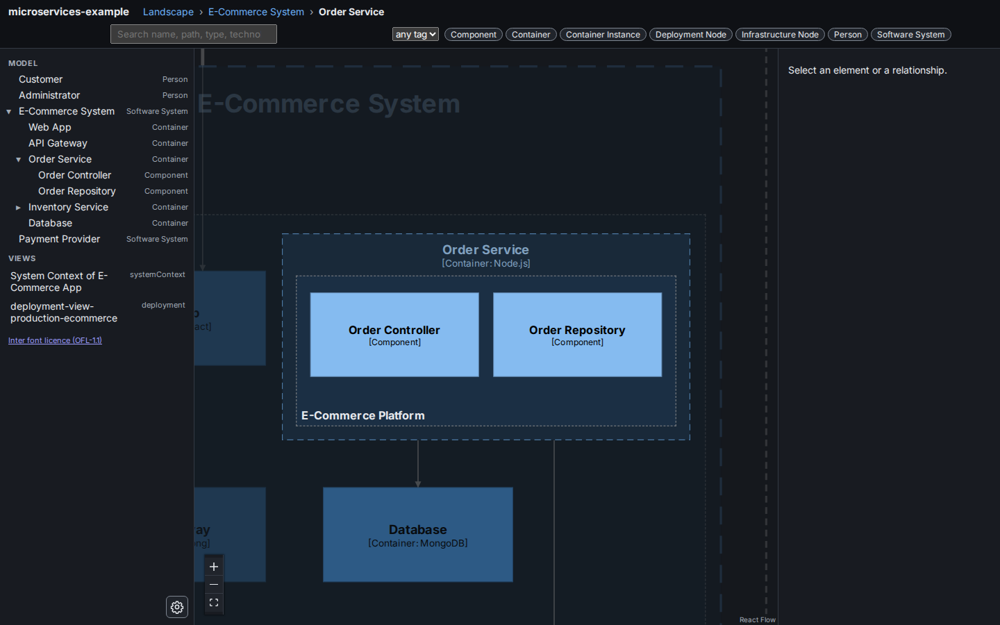

# Viewer settings

The viewer is the web page inside a built workspace that draws your diagrams. Its settings panel holds options that change how the canvas behaves and how the viewer looks. You can also [embed the viewer](#embed-the-viewer-in-another-page) in another page.

Each reader's browser keeps that reader's settings. Settings are not part of the workspace, `buildzr.yaml` does not set them, and a [viewer link](viewer-hash-routes.md) does not carry them. Two people who open the same link can therefore see it with different settings.

## Open the settings panel

Click the gear button at the bottom right of the left panel. On a phone, the gear is at the bottom right of the navigation drawer, which you open with the ☰ button. The settings panel opens above the gear.

To close the panel, press `Esc` or click anywhere outside it. After `Esc`, the focus returns to the gear.

## Settings

| Setting | Id | Default | What it does |
|---|---|---|---|
| Theme | `theme` | System | Light or dark. System follows the light or dark setting of your device, and changes when the device changes. See [Themes](#themes). |
| Zoom in to expand | `zoomExpand` | off | Zooming in on a collapsed frame (a box that contains other boxes) expands it, the same as clicking it. This adds one history entry, so Back returns. The frame expands when the centre of the canvas is inside it and the zoom is at least 90% of the zoom at which the frame fits the canvas. The viewer starts loading the inner diagram at 60%. Zooming out always collapses, whatever this setting is. |

## Themes

The viewer has a light and a dark theme. Pick one under **Theme** in the settings panel: **System**, **Light** or **Dark**. System is the default and follows your device.


*The light theme: the Order Service expanded inside the E-Commerce System.*



*The dark theme, the same view. The boxes keep the model's colours; the frame name is lightened.*

Both themes keep the colours of your model. Element boxes keep their fill and their text colour, including the colours your styles set. Where a colour would be hard to read on the page, the viewer lightens it in the dark theme and darkens it in the light theme: the names of expanded frames, the outlines of boxes, the arrows and their labels. Text keeps a contrast of at least 4.5:1 and the edges of boxes and controls at least 3:1, as WCAG AA asks.

The theme is applied before the page is drawn, so the viewer never flashes the other theme while it loads. A page that [embeds the viewer](#embed-the-viewer-in-another-page) chooses the theme of its frame with `theme=` or the `buildzr:theme` message.

The theme changes the viewer and the images you [download from it](#download-the-diagram-as-an-image), which are drawn in the theme on screen. It does not change what `buildzr export` writes: PlantUML, SVG and PNG files from the command line are not affected.

## Download the diagram as an image

**Download PNG** and **Download SVG** are at the top right of the canvas. They save the diagram you are looking at: the model canvas at its current place (the landscape or an opened element), or the authored view that is open, of any kind (system context, container, component, dynamic, deployment, custom). The file is made in your browser. Nothing is sent to a server, and the export needs no Java, PlantUML, Graphviz or extra browser.

**What is in the file**

- The whole diagram, however much of it the canvas shows. Zooming in or panning before you export does not cut anything off, and a margin of 24 px is left around it.
- The diagram as the viewer draws it: the same layout, boxes, boundaries, arrows, arrow labels and colours, in the theme on screen. The font (Inter) is part of the file, so the text looks the same on a computer that does not have it.
- Not in the file: the toolbar, navigation, zoom controls, the export buttons, the selection outline, search highlights and the "N matches" badges, and the thicker line of a selected arrow. Boxes that a search or tag filter dims stay dimmed, as on screen: clear the filter first for a plain diagram.
- The level of detail follows the zoom, as it does on screen. Small text that the viewer hides at the current zoom (a description, or a name that does not fit its box) is also hidden in the file. Zoom in, or open the element, before you export to get more.

**File names** are `<workspace>--<what is drawn>.<png or svg>`, in lower-case letters, digits and single hyphens. The model canvas is `model` (landscape) or `model-<element path>`, for example `shop--model-online-shop.png`; an authored view is its key, for example `shop--shop-containers.svg`. The same drawing always gets the same name, and no character that a file system could reject is ever used. Accents are dropped (`Café` is `cafe`). A name with letters that have no plain form, such as Chinese, gets a short tag so two such workspaces never share a name.

**Background.** Both formats have an opaque background in the canvas colour of the theme on screen: white in the light theme, dark grey in the dark theme. That is deliberate: the viewer lightens text and arrows in the dark theme so that they can be read on a dark canvas, so a file without a background can be unreadable on a page of the other theme. Tick **Transparent background** to leave the background out, for a figure that you put on a page of the same theme. The choice is not remembered between visits.

**PNG** is drawn at twice the size on screen (2 pixels for each pixel of the diagram), which is sharp in documents and on high-density screens. A very large diagram is drawn at a smaller scale, down to half size, so that the browser can draw it (about 16 million pixels, at most 16 384 on a side). Beyond that the export stops with a message and suggests SVG, which has no such limit.

**SVG** is the viewer's own drawing saved as one self-contained file, with the font inside, so it is larger than the PNG: several hundred kilobytes for a small diagram. It opens on its own in current Chrome, Edge and Firefox, and works in a web page through `` or as a link. The text stays text. Because the viewer draws its labels with HTML, the SVG holds them in a `foreignObject`, an SVG feature that browsers support and that some other programs may not: a vector editor, slide program or converter that draws only plain SVG shapes can leave the text out. Use the PNG for those. For an SVG made of plain SVG elements, use `buildzr export`, which draws with PlantUML and its own layout.

**If the export fails**, the viewer shows a notice that names the file and says what to do (try the other format, or reload the page). The diagram and everything else keep working, and you can try again. The commonest cause is a diagram too large for the browser to draw as a PNG; SVG works there.

This is not the command-line export. `buildzr export` draws views with PlantUML and its layout, so its pictures differ from the viewer's. The images here are what the viewer shows. An unattended command that exports with the viewer's own renderer is planned separately (see the [roadmap](https://buildzr.dev/roadmap/)).

## Step through a dynamic view

A [dynamic view](user-guide/views.md#dynamic-view) draws an ordered sequence of interactions. When one is open, a small bar at the top of the canvas lets you follow the interactions one at a time. It shows on dynamic views only.

| Button | Key (while the bar has the focus) | What it does |
|---|---|---|
| First step | `Home` | Shows step 1. |
| Previous step | `←` | Shows the step before. |
| Play / Pause | `Enter` or `Space` on the button | Shows the next step every 2 seconds and stops at the last one. Pause keeps the step on screen. At the last step, Play starts again from step 1. |
| Next step | `→` | Shows the step after. `End` shows the last step. |
| Show the whole diagram (×) | `Esc` | Leaves the steps and draws the whole diagram again. |

At each step the arrow of the current interaction is drawn thicker and its label is outlined. The arrows of the earlier steps are drawn as usual. The arrows of the later steps, and the boxes that no step has reached yet, are dimmed. The boxes never move and the camera stays where you put it. The bar shows **Step 3 of 7** and the interaction, for example *Web App → API: Posts the order to*. Screen readers announce each step. Two interactions with the same order number (a parallel sequence) are one step.

The keys work only while the focus is in the bar: press `Tab` to reach it. On the canvas, the arrow keys and `Space` keep their usual meaning.

The diagram opens with all its steps drawn, as before. Selecting a box or an arrow, opening another view or another place in the model shows the whole diagram again. The step is not part of the [viewer link](viewer-hash-routes.md). An image you [download](#download-the-diagram-as-an-image) while a step is on screen is drawn as you see it, dimmed arrows included.

When your device asks for reduced motion, the steps change without the short fade, and Play still works: it changes the step on a timer and moves nothing on the screen.

In an [embedded viewer](#embed-the-viewer-in-another-page) the bar works the same. A frame lower than 240 px has no room for it: the dynamic view is then drawn whole, without the bar.

## Fonts, About and third-party notices

The viewer sets its text in Inter, regular and bold. Both weights are part of the viewer bundle, so a built workspace shows the same font offline, behind a firewall or from a file share: the page asks no font host for anything. Code and error output keep your system's monospace font. A workspace with a [branding font](user-guide/themes.md#branding) has its diagrams set in that font when your computer has it.

To read what the viewer includes, click **About** at the bottom left of the left panel. On a phone, it is at the bottom left of the navigation drawer. The dialog describes the viewer and the font and shows the third-party notices: the licence and copyright notice of every library and font in the viewer. Press `Esc`, click **×** or click outside the dialog to close it; the focus returns to **About**. The dialog reads the notices from a file next to the page, and **Open as a plain text file** shows the same file in its own tab. Opening About does not change the [viewer link](viewer-hash-routes.md).

The same notices are in the package as `THIRD_PARTY_NOTICES.txt`: in the wheel under `buildzr-<version>.dist-info/licenses/` and at the root of the source distribution.

## How the browser keeps the settings

The viewer stores the settings in the browser's `localStorage`, under the key `buildzr-ui:settings`, as one JSON object, for example `{"zoomExpand":true,"theme":"dark"}`. When the viewer loads, it ignores unknown keys and values of the wrong type, and uses the default instead. If the browser blocks storage, the settings still work until the page is closed.

Tests and scripts can read the current values from `window.__viewer.settings`.

## Add a setting (for contributors)

All settings are defined in one list, `SETTINGS` in `viewer/src/settings.ts`. To add a setting, add an entry:

```ts
{ id: 'myOption', type: 'boolean', default: false, label: 'Short label', description: 'One line that says what it does.' },
```

The panel, the default, the validation and the storage follow from the entry. Read the value where you need it:

```ts
const on = useStore((s) => s.settings.myOption);   // in a component
useStore.getState().settings.myOption;             // anywhere else
```

Two kinds of setting exist: `boolean` (a switch) and `choice` (a row of options, such as the theme). A new kind of control, such as a number, needs two changes: a new `type` in `settings.ts` (its definition, and its validation in `parseSettings`), and a matching `case` in `Control` in `viewer/src/SettingsPanel.tsx`.

## Embed the viewer in another page

You can show the viewer inside another web page, such as a documentation page, in an `<iframe>`. In embed mode the viewer is compact: one header row, the model tree in a drawer behind the ☰ button, and an inspector that opens only when the reader selects something. The buildzr documentation uses it to draw the diagram of an example.

This section is the reference for pages that embed the viewer.

### Switch on embed mode

Add `embed=1` to the search part of the viewer's URL. The hash after it stays a normal [viewer link](viewer-hash-routes.md), so it picks what the frame opens on:

```html
<iframe src="viewer/index.html?embed=1&theme=dark#/m/shop" title="Diagram of the shop"></iframe>
```

| Parameter | Values | Default | What it does |
|---|---|---|---|
| `embed` | `1` | off | Embed mode. Without it, the URL opens the full viewer. |
| `data` | `message`, `server` | `message` | `message`: the viewer waits for your page to send the data. `server`: the viewer reads `data/` next to its `index.html`, as the full viewer does, so you can embed a built workspace. |
| `theme` | `light`, `dark`, `system` | the reader's own setting | The theme from the first paint on. Pass the theme of your page so the frame never flashes the other one. |

In embed mode the viewer:

- does not open the inspector or the bottom sheet when the frame loads, even when the link selects an element;
- never adds entries to the browser history, so the Back button of your page keeps working;
- fits any frame from 360 px to 1200 px wide without scrolling sideways. Below 768 px it uses its phone layout.

Each frame is its own page, so two frames on one page never share a selection or a route.

### Send the data

The viewer and your page talk with `postMessage`. Wait for `buildzr:ready` from the frame, then send `buildzr:load` with the files of the `data/` folder of a built workspace:

```js
const frame = document.querySelector('iframe');
addEventListener('message', (e) => {
  if (e.source !== frame.contentWindow || e.origin !== location.origin) return;
  if (e.data?.type === 'buildzr:ready') {
    frame.contentWindow.postMessage({ type: 'buildzr:load', files }, location.origin);
  }
});
```

`files` maps each path, relative to `data/` and written as `index.json` writes it, to the file's JSON text or to the parsed object. It must contain `index.json` and every file that `index.json` names. You can send `buildzr:load` again at any time, for example when the reader runs a changed example: the frame starts again from the new data.

### Send several workspaces

When your page has more than one workspace, such as a snippet that creates two, send them all in one `buildzr:load`, with `workspaces` in place of `files`. The viewer then shows a **Workspace** selector in its navigation drawer, and the reader switches between them without another message from you:

```js
frame.contentWindow.postMessage({
  type: 'buildzr:load',
  active: 'Billing',
  workspaces: [
    { name: 'Shop', files: shopFiles },
    { name: 'Billing', files: billingFiles, route: '#/m/ledger' },
  ],
}, location.origin);
```

Each entry has a `name` (shown in the selector, at most 200 characters, different from the others), `files` as above and, optionally, `build` and `route`. A message holds 1 to 50 entries. `active` names the one to show first; without it, the first. The `route` of the message, when it has one, applies to the active workspace, and otherwise the route of that entry does. Switching opens the other workspace on its own `route`, or on the landscape when it has none. It adds no history entry.

With one entry, the viewer behaves as for `files` and shows no selector. The "Open in a new tab" button opens the workspace on screen and keeps the selector in the new tab.

### Messages

Every message is an object whose `type` starts with `buildzr:`. The viewer ignores fields it does not know, and ignores a message whose fields have the wrong type.

From your page to the viewer:

| `type` | Fields | What it does |
|---|---|---|
| `buildzr:load` | `files` (required, or `workspaces`, see [Send several workspaces](#send-several-workspaces)), `build` (optional `build.json` object), `route` (optional hash such as `#/m/shop`), `title` (optional) | Draws the data. With a `build` whose `status` is `broken`, the frame shows the same broken-workspace message as the full viewer. |
| `buildzr:theme` | `theme`: `light`, `dark` or `system` | Switches the theme of the frame. The viewer does not store it. |
| `buildzr:route` | `route`: a hash, for example `#/m/shop?sel=shop/api` | Opens that place, like a [viewer link](viewer-hash-routes.md). It does not open the inspector. |

From the viewer to your page:

| `type` | Fields | When |
|---|---|---|
| `buildzr:ready` | `v`: the protocol version, `1` | The frame listens. Send `buildzr:load` after this message, not before. |
| `buildzr:loaded` | `status`: `ready`, `broken` or `error`; `error` when there is one | After each `buildzr:load`, or after the data from the server is read. |
| `buildzr:route` | `route`, `view`, `path`, `selection` | The reader moved or selected something. |
| `buildzr:workspace` | `name` | The workspace on screen changed: after a `buildzr:load` that has `workspaces`, and each time the reader picks another one. |
| `buildzr:open` | `url` | The reader opened the model in a new tab. You do not need to do anything. |

The viewer fills its frame and sends no height. Choose a height that suits your page, for example `min(560px, 80vh)`.

### Origin rules

- The viewer accepts a message only from its parent frame and only from its own origin, and it posts only to its own origin. It never uses the `*` target.
- Serve your page and the viewer from the same origin. Any static host works, such as GitHub Pages or `python -m http.server`. Pages opened from `file://` do not work, because the browser gives them no origin to check.
- Do not sandbox the frame. If you must, allow `allow-scripts allow-same-origin allow-popups allow-popups-to-escape-sandbox`.

### Open in a new tab

In embed mode the header has an **Open in a new tab** button. It opens the full viewer, with the model tree, the inspector and history, on the same model and the same place.

When your page sent the data, there is no URL that holds it. The new tab opens `index.html?handoff=<id>` and asks the frame that opened it for the data. It keeps a copy for the session, so reloading the tab works even after your page is closed. If the frame is gone before the tab receives the data, or the reader ran the example again since, the tab says that the diagram is no longer available and asks the reader to press the button again.

With `data=server`, the button opens the viewer's own URL without `embed`.
