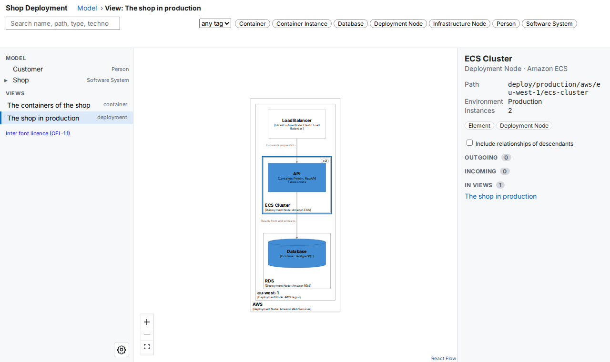
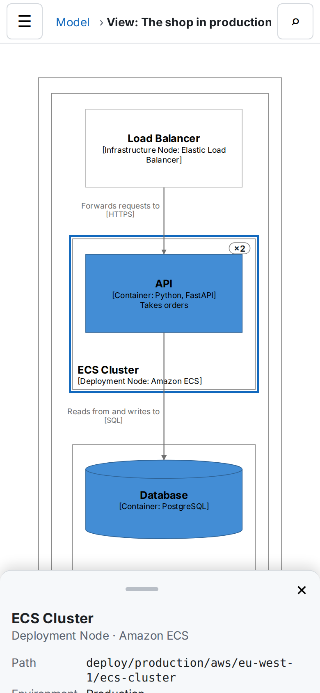

# Deployment Views

A deployment view shows where the containers of your model run: which cloud, which region, which cluster or server, and how many copies of each. This page shows how to write one, build it, and read it in the viewer.

You need a model with containers (see [Models](models.md)) and buildzr with its `buildzr` command (see [Installation](../getting-started/installation.md)).

## 1. Write the deployment model

A deployment model has three parts:

- a `DeploymentEnvironment`, such as Production or Staging;
- `DeploymentNode`s inside it, nested as deep as you need: a cloud provider, a region, a cluster, a server;
- `ContainerInstance`s (or `SoftwareSystemInstance`s) inside the nodes: the containers that run there. `InfrastructureNode`s are the other things on a node, such as a load balancer or a DNS service.

Save this as `workspaces/shop.py`:

<!-- doctest: file workspaces/shop.py -->
```python
# norun
from buildzr.dsl import (
    Workspace, Person, SoftwareSystem, Container,
    DeploymentEnvironment, DeploymentNode, InfrastructureNode, ContainerInstance,
    ContainerView, DeploymentView, StyleElements,
)

with Workspace('Shop Deployment') as w:
    customer = Person('Customer')
    with SoftwareSystem('Shop') as shop:
        api = Container('API', technology='Python, FastAPI', description='Takes orders')
        db = Container('Database', technology='PostgreSQL', tags={'Database'})
    customer >> ("Buys from", "HTTPS") >> api
    api >> ("Reads from and writes to", "SQL") >> db

    with DeploymentEnvironment('Production') as production:
        with DeploymentNode('AWS', technology='Amazon Web Services'):
            with DeploymentNode('eu-west-1', technology='AWS region'):
                lb = InfrastructureNode('Load Balancer', technology='Elastic Load Balancer')
                with DeploymentNode('ECS Cluster', technology='Amazon ECS', instances='2'):
                    api_instance = ContainerInstance(api)
                with DeploymentNode('RDS', technology='Amazon RDS'):
                    ContainerInstance(db)
                lb >> ("Forwards requests to", "HTTPS") >> api_instance

    ContainerView(software_system_selector=shop, key='shop-containers', description='The containers of the shop')
    DeploymentView(environment=production, key='production', software_system_selector=shop,
                   description='The shop in production')
    StyleElements(on=['Database'], shape='Cylinder')
```

- `instances='2'` says the ECS Cluster runs two copies. It takes a number or a range such as `'0..N'`.
- You do not write relationships between instances. The API container reads from the Database container, so buildzr gives the API instance the same relationship to the Database instance.
- `DeploymentView` takes the environment object, not its name. `software_system_selector` limits the view to the instances of one software system; leave it out to show every instance of the environment.

## 2. Build and open the view

Build the workspace and serve it:

```text
$ buildzr serve
built .buildzr/build/shop-deployment (11 elements, 3 relationships, 2 views; modelHash sha256:a464017ed5c8…)
Serving .buildzr/build at http://127.0.0.1:8000/ (Ctrl+C to stop)
  http://127.0.0.1:8000/shop-deployment/
Workspace list at http://127.0.0.1:8000/_buildzr/v1/workspaces
```

The 11 elements are the person, the system, its two containers, and the seven deployment elements: four nodes, the load balancer and the two instances. Open the address and pick **The shop in production** under **Views**, or open `http://127.0.0.1:8000/shop-deployment/#/v/production` directly:


*The deployment view of the Production environment. Each deployment node is a box around what runs on it, with its name and technology in the bottom-left corner.*

What the view draws:

- **Deployment nodes** are boxes around what runs on them, nested as in the model. A node with more than one instance has a badge in its top-right corner: `×2`.
- **Instances** look like the container they are an instance of: the same name, technology, description and style. The Database instance is a cylinder because the Database container has the tag `Database`.
- **Infrastructure nodes** are boxes with `[Infrastructure Node: <technology>]`.
- **Arrows** are the relationships between the drawn elements. An arrow between two instances stands for the relationship between their containers.

A node with nothing inside it, no instance and no infrastructure node, is not in the view.

## 3. Select a node or an instance

Click a box to select it. The inspector on the right shows what the model says about it:



*The ECS Cluster selected. The inspector shows its environment and its number of instances.*

- For a deployment node, the inspector shows the environment and the number of instances.
- For an instance, it shows **Instance of** with a link to the container. **Show in model** opens the container in the model, where you can see what it is made of.
- Search and the tag filter work in deployment views as in the other views: the matching boxes stay bright and the others are dimmed.

The model tree on the left lists the people, software systems, containers and components only. To reach a deployment element, open its deployment view or search for it.

## 4. Link to a deployment element

Every deployment element has an id that starts with `deploy/` and the environment: the ECS Cluster is `deploy/production/aws/eu-west-1/ecs-cluster`, and the API instance on it is `deploy/production/aws/eu-west-1/ecs-cluster/api`. An instance takes the name of its container.

To link to a selected element, add `?sel=<id>` to the view's address:

```text
http://127.0.0.1:8000/shop-deployment/#/v/production?sel=deploy/production/aws/eu-west-1/ecs-cluster
```

The link `#/m/<id>` of a deployment element also works: it opens the first deployment view that shows the element. See [Viewer links](../viewer-hash-routes.md) for every form of link.

## 5. On a phone

On a screen narrower than 768 px, the view fills the screen. Tap a box to select it; the inspector opens as a sheet at the bottom:



*The same view on a phone, 390 px wide, with the ECS Cluster selected.*

## 6. Ask the Model API

The [Model API](../model-api.md) answers questions about deployment elements too. For example, this request lists the container instances and where they run (`parent`):

<!-- doctest: api page -->
```http
GET /shop-deployment/api/v1/elements?type=ContainerInstance
```

```json
{
  "apiVersion": "1",
  "modelHash": "sha256:a464017ed5c8d6faffd1473e7f0653646c6c0b7d0522203cf1366b1ade2a23de",
  "total": 2,
  "items": [
    {
      "id": "deploy/production/aws/eu-west-1/ecs-cluster/api",
      "name": "API",
      "type": "ContainerInstance",
      "parent": "deploy/production/aws/eu-west-1/ecs-cluster",
      "description": "Takes orders",
      "technology": "Python, FastAPI",
      "tags": [
        "Container Instance"
      ],
      "childCount": 0,
      "viewerUrl": "/shop-deployment/#/v/production?sel=deploy/production/aws/eu-west-1/ecs-cluster/api"
    },
    {
      "id": "deploy/production/aws/eu-west-1/rds/database",
      "name": "Database",
      "type": "ContainerInstance",
      "parent": "deploy/production/aws/eu-west-1/rds",
      "description": null,
      "technology": "PostgreSQL",
      "tags": [
        "Container Instance"
      ],
      "childCount": 0,
      "viewerUrl": "/shop-deployment/#/v/production?sel=deploy/production/aws/eu-west-1/rds/database"
    }
  ],
  "next": null,
  "truncated": false
}
```

`GET /shop-deployment/api/v1/views?environment=production` lists the deployment views of Production. See [Deployment elements](../model-api.md#deployment-elements).

## Several environments

Write one `DeploymentEnvironment` per environment and one `DeploymentView` for each. Every environment gets its own ids: `deploy/staging/...` and `deploy/production/...`. Two environments whose names differ only in case or punctuation get `-2` on the second one, for example `deploy/prod-2/...`.

Deployment groups (`DeploymentGroup`) decide which instances get the relationships of their containers; the view does not draw them as boxes.
